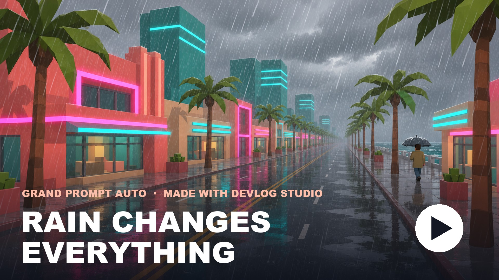
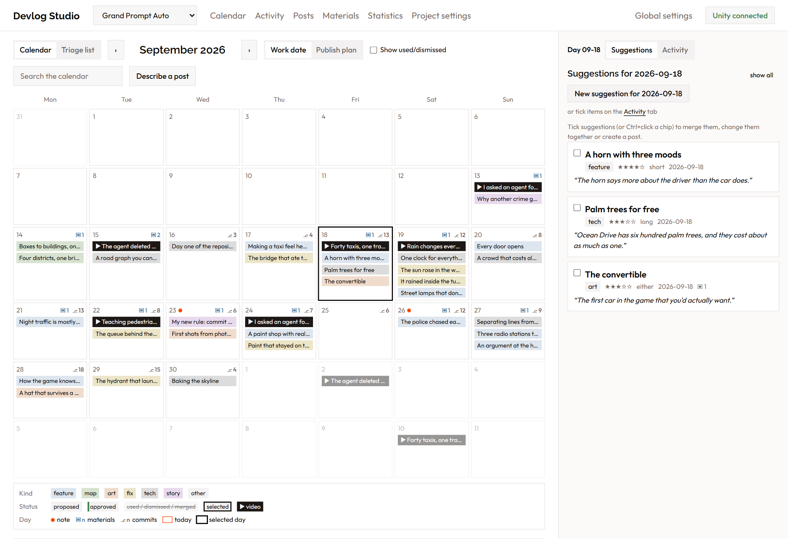
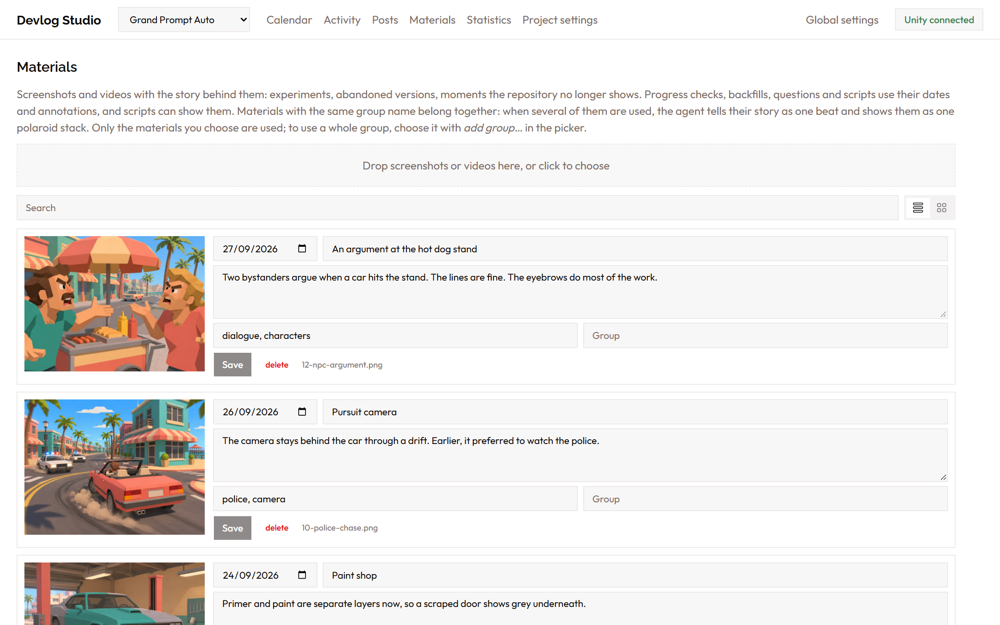
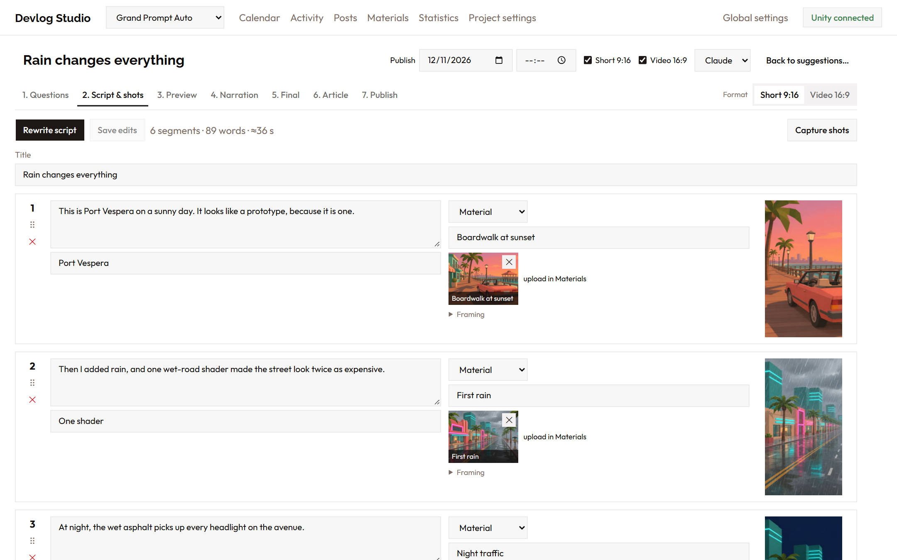
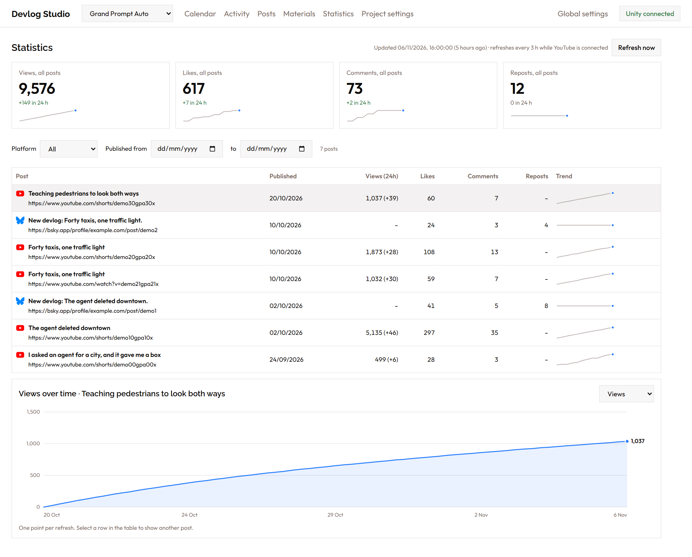
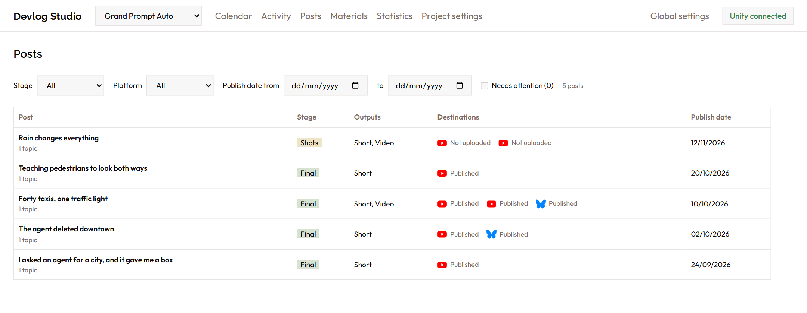
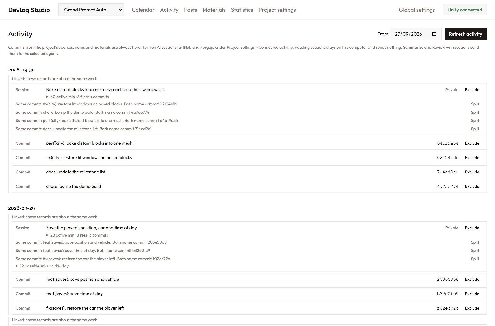

# Devlog Studio

To set up Devlog Studio with a coding agent, paste this sentence into the agent:

```text
Clone https://github.com/immerstory/devlog-studio.git, follow the Requirements and Start sections of its README to install what's missing and start the app, then tell me what I still have to do myself, such as signing in to a CLI or entering an API key.
```

Devlog Studio turns daily progress on a software project into devlog posts. One post can become:

- a vertical Short (9:16) and a landscape YouTube video (16:9), with subtitles and ElevenLabs narration;
- a blog article with pictures, for a folder or a Git-based site;
- short texts for Bluesky and LinkedIn.

The app reads the project's Git history, uncommitted content files, your notes and your uploaded screenshots and videos. It proposes topics on a calendar and asks you what to highlight. Then it writes a script, captures shots in a browser, the open Unity editor or Blender, and renders the videos. It also writes the article and the short texts. Nothing is published until you approve it.

[](https://youtu.be/0AxgHBwaNzI)

The video and screenshots show Grand Prompt Auto, a game invented for this README. Its images, activity and statistics are made up.



Each project has a type: game, web app, mobile app, industry news or something else. The type sets the default prompt text that tells the agent who it writes for and which shots work well. You can edit that text in the project settings and restore the default at any time.

## Requirements

- Node.js 22 and ffmpeg/ffprobe on `PATH`
- Internet access for the first webpage shot, which downloads Chrome headless shell into `cache/chrome`
- Docker with Compose, for Postgres and Garage
- `claude` (Claude Code) or `codex` CLI, signed in
- For Unity capture: the Unity editor open on the project, with a [Unity-MCP](https://github.com/IvanMurzak/Unity-MCP) server running over HTTP (see **Unity capture** below). The project needs the Universal Render Pipeline on Unity 6.
- For Blender capture: Blender open on the same computer, with the [MCP for Blender](https://github.com/ahujasid/mcp-for-blender) add-on connected (see **Blender capture** below)
- For generated images: `codex` CLI, signed in
- An ElevenLabs API key, needed only for narration

## Start

1. Run `npm install`.
2. Run `npm run setup`. It generates credentials in `.env` and `docker/garage.toml`, starts Postgres and Garage, and creates the Garage bucket and key. Running it again keeps existing values.
3. Run `npm start` and open <http://localhost:4777>.
4. Under **Settings**, paste the ElevenLabs API key and enter a voice ID. **Check voice** confirms that the ID exists.

The app listens on 127.0.0.1 only. The containers publish Postgres on 127.0.0.1:5544 and Garage S3 on 127.0.0.1:3940. They restart with Docker.

## Agent costs

Agents run through the signed-in CLIs, so they use your Claude or ChatGPT subscription. The logged "API-equivalent cost" is the list price the CLI reports; it is not billed separately. If `ANTHROPIC_API_KEY` is set in the environment, `claude` bills per token instead.

## Workflow

Long work (progress checks, backfills, questions, scripts, captures, narration, renders, articles, uploads) runs on the server as a task. While a task runs, a floating task box at the bottom right shows it with its latest log line; click a task to see its full log. **Cancel** stops a task at its next step: a capture after the current shot or frame, an agent run, a render or an upload at once. Work already finished, such as shots captured before the cancel, is kept. You can keep working anywhere in the app meanwhile, and when a task finishes, the page of its project shows the results. Finished tasks stay listed for two minutes, failed ones until you hide them. Tasks live in the server's memory: restarting the server stops running tasks, and the task box reports them as stopped.

1. **Add materials.** On **Materials**, upload screenshots and videos with the date they show, a title, tags and an annotation: the story behind them, such as an experiment, an abandoned version or a bug. To add files to an upload form, drop them on it, paste them or click to choose them. Materials appear on the calendar on their date. Image materials can also serve as slide backgrounds; they are used in turn and blurred. Without any, slides use blurred captures from the video itself. Choose them in the project's theme (see **Theme** below). A source can also supply materials from its committed files (see **Materials from a Git source** below).

   

2. **Fill the calendar.**
   - **Backfill history** proposes suggestions for a past date range. It runs one agent call per week of commits, notes and materials, and dates each suggestion on the day the work happened. Processed weeks are remembered and skipped unless you select **re-run processed weeks**. Backfill does not change the progress-check state.
   - **Sidebar.** The first group is about the selected day: **Suggestions** lists its suggestions, **Activity** its notes, commits and materials (day cells show commit and material counts; a dot marks a note).
   - **New suggestion for a day.** Tick notes, commits and materials on **Activity**, or upload materials or add notes there; the form on **Suggestions** collects them. **Create suggestion** uses your own title and text; **Write up with agent** sends the ticked items and your text to the flow below. Any mix works, including text alone, for example a "how it started" story.
   - **A post you describe.** **Describe a post** takes what you want to say, including what you no longer have, and lets you upload new material or attach existing material for the draft to use. **Tell it differently** on a suggestion does the same from that suggestion. The agent searches two weeks either side by default: commits, sessions, notes and materials, plus all suggestions and posts. It returns one draft that lists which shots have material and which you must capture, what the evidence doesn't show, and which open suggestions it would replace. Nothing changes until you choose **Add suggestion**. Replaced suggestions are marked as merged, and their materials don't carry over.
   - **Propose changes since last check** reads commits since the previous check, uncommitted scene, prefab, terrain and material changes that differ from that check, and notes and materials added since then.
   - **Daily intake.** Under **Project settings > Sources > Daily intake**, choose a time of day. Each run refreshes activity, which calls no agent. Tick **Propose changes since last check**, **Propose from feeds** or **Review with sessions** to add those steps. They call the default agent, and its provider bills each run. The review takes the complete weeks of the last four that aren't reviewed yet, so a week is reviewed on the Monday after it ends. The intake runs only while the app runs. A time missed while the app is off runs once after the next start, unless the next time is at most an hour away. Turning the schedule on waits for its next time. **Run now** runs the saved steps at once.
3. **Triage.** Use **Calendar** to see suggestions by work date or publish plan. Use **Triage list** to filter by status, kind, appeal, date or text. Select suggestions to approve, dismiss, restore, merge or schedule them together, or to create a video. Open a suggestion to edit it and to attach or upload materials. Select an attached material to edit it or delete it.
4. **Questions.** The post's suggestions appear as **Topics**, with all their fields; edit them there before the agent researches. Attach more materials to the video if needed. The agent reads the topics, annotations and preview images, researches the repository and asks up to six questions. **Back to suggestions…** in the post's header deletes the post with its questions, scripts, captures and renders, and returns its suggestions to the approved list. Final videos in `output/` stay. A post with a video on YouTube can't be turned back.
5. **Script & shots.** The agent writes narration and a shot list for each format. Every segment shows one of these visuals:

   

   - **Editor shot:** a camera render from the open Unity editor or Blender file (see **Blender capture** below for what differs there). A target object is framed automatically, and an occlusion check keeps walls out of the way. Optional camera moves are orbit (swing around the shot's centre), push (move toward it), pan (slide sideways, still looking ahead), turn (swivel on the spot) and rise (move up). Orbit, pan and turn are centred on your framing: an orbit of 40° starts 20° to one side and ends 20° to the other. Choose the target with **Pick object…** (search by name or browse the hierarchy of all loaded scenes) or **Use Unity selection** (the object selected in Unity). Paths add an index such as `[1]` when siblings share a name. To frame a shot yourself, set up the Scene view in Unity, then select **Use Scene view**. The first surface in the middle of the view becomes the shot's centre for push and orbit; the shot shows which object it lies on and how far away it is.
   - **Webpage shot:** a page filmed in headless Chrome, for a project with a browser capture target (**Project settings > Capture targets > Add browser target**, with an optional base URL so shots can use paths such as `/pricing`). The page scrolls from one position to another and can zoom in on a focus point; positions are pixels from the top or a CSS selector such as `#features`, which is brought to the top of the view. By default the move spans the whole shot with a smooth start and stop; **Start after** holds the page still for some seconds first, **Speed** sets the scroll speed in pixels per second (a scroll too long for the shot stops partway, and the task log says so), and **Movement** switches to a constant speed. Zoom follows the same timing. The page is shown on a phone or a desktop viewport (by default a phone for Shorts and a desktop for landscape videos). Its own animations, transitions and videos play at their real speed, because page time advances exactly one frame per filmed frame. **Hide** takes CSS selectors of elements to remove first, such as cookie banners. **CSS for this shot** adds your own CSS to the page after it loads, and the browser target's **CSS for every page** does the same for all its shots; the shot's CSS comes last, so it can override the target's. Pages that need a sign-in can't be filmed yet. Many search engines and some other sites answer automated browsers with a bot check; the shot then fails right away with the site's response (for example HTTP 429 and a CAPTCHA page). For those, record the page yourself and upload it as a material. The browser target's **User agent** setting replaces the browser's own one; empty uses Chrome's for desktop shots and an iPhone Safari one for phone shots. **Request headers** are sent with every request, one `Name: value` per line. By default they are the privacy signals `DNT: 1` (Do Not Track) and `Sec-GPC: 1` (Global Privacy Control), which the page's scripts also see, and `Accept-Language: en-US,en;q=0.9`, which asks for English pages; an empty list sends none. The browser is Chrome headless shell, which the app downloads on the first webpage shot.
     - **Credit and link.** The video shows the shot's **Credit**, such as `Outlet · Author`, and the page's link in a slim band along the bottom edge. A slide can have a credit too, for a statement it quotes. Clear **Show the credit and link in the video** to leave both out. For a page that is a source, the script writer fills in the credit and **Expected text**, usually the article's headline.
     - **Film the page playing.** A shot without a scroll, zoom or highlight is a single still. With this switch on, it's filmed frame by frame for the whole shot, so the page's background videos and animations play.
     - **Real time.** Filming normally runs on an exact frame clock, which streamed videos, such as a site's background video, don't play under. With **Real time**, the page runs on its own clock and each frame takes the picture due at that moment; a frame the browser can't deliver in time repeats the one before, so motion may stutter. Real time also films a shot without a move as a moving picture.
     - **Script for this shot.** JavaScript that runs in the page after its CSS and before filming, as the body of an async function. Use it, for example, to start a video the site won't play by itself; an error in it fails the shot.
     - **Highlight.** A sentence or phrase exactly as the page writes it. The page then holds still on it and a marker sweeps across it word by word, instead of scrolling. Late content that pushes the sentence down doesn't lose it. The script writer sets it when the narration reports what the page says.
     - **Ads.** The browser doesn't load known ad networks and hides leftover ad slots and the messages sites put in them.
     - **Cookie dialogs.** Before checking and filming a page, the browser refuses optional cookies with the dialog's own refuse button, such as **Reject all** or **Decline optional cookies**, and hides what still floats over the page: any modal dialog, privacy notices with their backdrops, and closable bars about the country, language, cookies, surveys or newsletters. While filming, it hides such popups again twice a second. Hiding a notice agrees to nothing. It looks again just before filming, because some dialogs open late. A dialog that still covers the page fails the shot; hide it with a CSS selector under **Hide**. A consent wall in a frame and a paywall also fail the shot and are never hidden: show that source on a slide instead. Checks open each page in the shot's device size, because sites show phones other banners and paywalls.
     - **Checks.** Each time a page is filmed, the capture checks it first. An error status such as HTTP 404 fails the shot. When the page doesn't show the expected text or the sentence to highlight within a few seconds, the shot fails too. Case, spacing, quotes and dashes don't matter. A shot with a credit or an expected text also fails when the link redirects to another site or to a homepage, because the article is gone. Other redirects, such as one that adds a language to the address, are only logged. The browser runs in English and asks for English pages; a site that picks its language by location needs an address with an explicit language, such as `meta.com/gb/…`. **Check links**, next to **Capture shots**, opens every webpage shot's page without filming it, and each shot shows the result of its latest check. For a post made from news feed topics, a source shot whose link the feed entries don't name is marked: the script writer found or built that link, so check that it is the article the segment cites.
   - **Material:** an uploaded screenshot or video. If the footage does not exist yet, the segment describes what to record; upload it and choose it in the segment. An animated GIF plays on a loop for the length of the segment.
     - **Generated images.** **Generate image** on a material segment, or **Generate missing images** for the whole script, has Codex create an image from the segment's description with its built-in image tool. Codex runs read-only, and the app takes the image from Codex's own image folder. The image becomes a material tagged `ai-generated` that keeps its prompt, and the video credits it as an AI-generated image in the band along the bottom edge. Every prompt asks for an illustrative scene without logos, brand names, readable text or identifiable people. Generation uses your Codex plan.
   - **Slide:** a title, bullets, image, before/after, stack or outro card in the theme's paper-and-ink style. Images can come from earlier segments or from materials. A stack shows any number of images as polaroids that drop from the top or slide in from alternating sides, piling up slightly rotated and offset; the slide lasts at least long enough for each polaroid to land.

   After writing, a second agent run reads the narration in order as a viewer would and fixes lines that do not follow, such as a reply to a question the video never asks. The job log lists each change and its reason. Turn this off under **Settings > Agent**. A segment whose narration you edited shows the agent's version with a **restore** link. Each script run's prompt, raw output and read-through edits are kept in the `runs` table; the script's `runId` points to its run.

   Select **Capture editor shots** to render every editor shot. Every capture is kept as a take with the settings that produced it (the last five per shot and format); **Previous take** goes back to the one before and restores its settings, discarding the current take.
6. **Preview.** The player shows the video without narration, drawn by the same code as the final export. Subtitles are timed at a typical narration pace. **Render draft MP4** writes a half-resolution file. This step costs no ElevenLabs credits.
7. **Narration.** The page shows how many characters are billable and your remaining ElevenLabs quota. Narration runs only after you confirm. Audio is cached by text, voice and settings, so unchanged lines are never billed twice. Subtitles then follow the real word timings.
8. **Final.** Renders a full-resolution H.264/AAC MP4 (BT.709, normalised to -14 LUFS with one constant gain and a peak limiter, so levels within the mix stay as authored) into `output/<date>-<title>/`, with an `.srt` file and a `.txt` file holding the title, description, tags, hashtags and, for landscape videos, chapters. Copies are archived in Garage. **Approve & upload to YouTube** publishes the video (see **Publishing** below).
9. **Article.** **Write article** has the agent write a blog article of 500 to 1200 words from the post's topics, your answers and its materials. A second run reads it as a first-time reader would and fixes what doesn't work for that reader, the same read-through that scripts get. Edit the text, place pictures and give each one alt text.
10. **Publish.** Add the post's destinations: Bluesky, LinkedIn, a folder or a Git-based site. **Write text** has the agent write a short text for Bluesky (up to 300 characters) or LinkedIn (up to 3,000). Approve each destination to send it (see **Publishing elsewhere** below).

**Theme.** Under **Project settings > Theme**, **Edit theme…** opens the project's look beside a looping preview of a title, bullets, a polaroid stack and the ending, in either format. The preview uses the values as you edit them. The theme covers:

- the slide colours: background, its highlight and edge, wash, text, accent and photo frame. The label over footage uses the background colour with the text colour on it, and swaps the two when the footage is dark behind it;
- the slide font (headings, bullet points, photo captions and labels) and the logo on title slides, uploaded as files (TTF, OTF or WOFF fonts; PNG, JPEG, WebP or SVG images) and stored in Garage;
- the slide backgrounds;
- whether subtitles show on title slides; without them, a title slide's heading carries the point while the narration plays;
- an optional intro and an optional outro.

**Intro and outro.** Each is a bumper: a short title sequence chosen from the installed styles, with that style's settings. The intro plays over the first segment, and that segment's narration and subtitles start after it. The outro plays over the end of the last segment.

The **Title card** style is built in: white text fades in on black, holds and fades out. Add your own styles with an extension (see **Extensions** below). A theme that names a style that isn't installed plays no bumper there.

**Bumper music.** Once a project has an intro or an outro, **Project settings > Theme** offers a music upload for it. The leading silence is cut on upload. Intro music starts with the video. For outro music, export your track against a full video, silent until the outro: the track is assumed to end with the video, so any music before the outro's start becomes a lead-in that plays before the title appears. The music keeps that position in every video, narrated or not. If you change the outro's length, for example its hold time, export the music again.

## Extensions

An extension adds bumper styles and theme presets without changing this repository. It's a folder with an `index.ts`, and the app finds it at startup. [`examples/title-card/index.ts`](examples/title-card/index.ts) is a complete example, and [`shared/extension.ts`](shared/extension.ts) defines the contract.

### Add an extension

1. Create `extensions/my-brand/index.ts`. Git ignores the contents of `extensions/`, so your files stay out of this repository.
2. Export the extension:

   ```ts
   import type { DevlogExtension } from "devlog-studio/extension";

   const extension: DevlogExtension = {
     id: "my-brand",
     name: "My brand",
     bumpers: [
       {
         id: "my-logo-sting",
         label: "Logo sting",
         description: "A title that fades in.",
         params: [{ key: "text", label: "Text", type: "text", default: "" }],
         seconds: () => 3,
         animation: {
           async prepare({ params, durationInFrames, width, height, title }) {
             return (ctx, frame) => {
               ctx.globalAlpha = Math.min(1, frame / 15);
               ctx.fillStyle = "#fff";
               ctx.font = "bold 96px sans-serif";
               ctx.textAlign = "center";
               ctx.fillText(String(params.text || title), width / 2, height / 2);
               ctx.globalAlpha = 1;
             };
           },
         },
       },
     ],
   };

   export default extension;
   ```

3. Restart the app. The style appears under **Project settings > Theme > Edit theme…**.

The same file runs on the server for the export and in the browser for the preview. So use no Node.js APIs in it, and import from Devlog Studio only with `import type`. Load fonts and other files in `prepare` through `platform`, because `prepare` runs once per video. The function it returns draws one frame on a transparent canvas of the video's full size, and frames can arrive in any order. If an extension fails to load, the app doesn't start, and the error names its folder.

### Add a theme preset

A preset applies colours, fonts, a logo, an intro and an outro in one step. Its file paths are relative to the extension's folder, and it can't name files outside that folder. A preset replaces what it defines and keeps the rest of the theme. A preset with `logo: null` removes the project's logo.

```ts
themePresets: [
  {
    id: "brand",
    label: "My brand",
    colors: { paper: "#f2ebdc", ink: "#211f1b" },
    displayFont: "assets/brand.ttf",
    logo: "assets/logo.png",
    outro: {
      style: "my-logo-sting",
      params: { text: "My game" },
      music: "assets/outro.wav",
    },
  },
],
```

Under **Project settings > Theme > Edit theme…**, choose the preset and select **Apply preset**. The app saves the result at once, and it stores the files in Garage like uploads. Bumper fonts go under `fonts`, by the key of the style's font parameter.

### Keep extensions in their own repository

Extensions often hold fonts, music and logos you can't publish. Choose one of these layouts:

- **Clone into the drop folder.** Run `git clone <your repository> extensions/my-brand`. The extension's repository stays independent, and this repository ignores it.
- **Use a separate folder of extensions.** Set `DEVLOG_EXTENSIONS_DIR` in `.env` to one or more folders, separated like `PATH` (`;` on Windows, `:` elsewhere). Relative paths count from this repository's folder. Each subfolder with an `index.ts` is an extension.
- **Add this repository as a submodule of your own.** This layout suits a project that keeps private material next to the tool:

  ```text
  my-devlog/              your private repository
  ├─ studio/              this repository, as a submodule
  ├─ extensions/my-brand/ your extension
  └─ output/              your final videos
  ```

  ```sh
  git submodule add https://github.com/immerstory/devlog-studio.git studio
  ```

  In `studio/.env`, set `DEVLOG_EXTENSIONS_DIR=../extensions` and `DEVLOG_OUTPUT_DIR=../output`. Run `npm install`, `npm run setup` and `npm start` inside `studio/`.

To type-check an extension outside this repository, map the import to the contract in its `tsconfig.json`:

```json
{
  "compilerOptions": {
    "module": "ESNext",
    "moduleResolution": "Bundler",
    "strict": true,
    "noEmit": true,
    "lib": ["ES2023", "DOM", "DOM.Iterable"],
    "paths": { "devlog-studio/extension": ["../../studio/shared/extension.ts"] }
  },
  "include": ["."]
}
```

## AI co-host

A video can be a conversation between your narrator and an AI co-host. The co-host asks what a viewer wants to know, challenges your decisions and teases you, and you state the facts. The only visual difference is the color of the co-host's captions.

1. **Turn it on.** Under **Project settings > Co-host**, select **Use a co-host in this project**, then enter a name and an ElevenLabs voice ID that differs from your narrator's. Use only a voice you have the right to use. You can also edit the persona, the caption color and the co-host's share of the words.
2. **Choose per video.** In a post's Questions step, set each format to **Solo** or **Co-hosted** before you write its script. Changing a format that has a script deletes that format's script, narration and render record. The change is refused once the format is on YouTube.
3. **Review the lines.** In **Script & shots**, each segment lists its lines with a speaker. You can edit, reorder, add or remove them. Narration generates one take per line, so editing a line bills only that line.
4. **Resolve the check.** While writing, an agent run lists the co-host's factual claims and looks for a source in your answers, the evidence and your earlier lines. Unsupported lines are rewritten once, and what remains becomes a flag. Choose **Keep anyway** to keep a flagged line.

Any later change to the script, your answers or the evidence makes the check out of date. **Check co-host lines** runs it again. It costs one agent run, it only flags lines, and it never starts on its own.

You can't approve or upload a co-hosted video until the check is current and has no open flags, and the final render matches the checked script. If only your answers or the evidence changed, a new check is enough. If the script changed, the video also needs a new final render.

A kept flag applies to that exact line, claim and reason, and to the answers, evidence and earlier developer lines behind it. If any of them changes, you decide again.

Co-hosted videos declare synthetic media on YouTube and add a line naming the AI co-host to the description. You can edit that line in the project's co-host settings. Subtitle files mark speaker changes with `>>`.

## Publishing

1. **Attribution.** Under **Settings > Publishing**, enter the text every description ends with: music licence IDs, credits, links.
2. **Final render.** The Final step shows the video and exactly what gets published: title, description (your description, chapters for landscape, `#Shorts` and hashtags made from the first two tags for portrait, then the attribution) and tags. Change the text in **Script & shots > Platform metadata** or in Settings, then render the final again.
3. **Approval.** **Approve & upload to YouTube** is the final OK. It uploads right away: scheduled for the episode's publish date and time (top of the episode; the default time comes from Settings), or, without a date or with a date already past, published as set under **Without a publish date**. A scheduled video stays private on YouTube until then. The subtitles are added as an English caption track. A new final render clears the approval.

**Connecting YouTube:**
1. In the Google Cloud Console, create a project, enable the **YouTube Data API v3**, and create an OAuth client of type **Desktop app**. Add yourself as a test user while the app is in testing.
2. Under **Global settings > Publishing**, add a YouTube connection, enter the client ID and secret and select **Save connection**. Then select **Connect** and approve access in your browser. The refresh token is stored in the settings and never sent to the browser.

YouTube allows 100 uploads per day per project.

**Statistics.** The Statistics page lists everything published in one table, whatever the platform, marked with the platform's icon. Above the table, you can filter by platform and by publishing date; the totals at the top stay for all posts. A number a platform doesn't report shows as a dash, such as views on Bluesky, and Bluesky replies count as comments. While YouTube is connected, the app fetches views, likes and comments of every uploaded video one minute after start and then every 3 hours (**statsIntervalHours** in the settings), storing one snapshot per refresh. The **Statistics** page shows the totals with their 24-hour change, a table of all videos and a chart of the selected video over time; **Refresh now** fetches immediately. A refresh also notices when a scheduled video has gone public. Uploading records the publication day as the episode's publish date, so the calendar shows the video on that day.



## Posts

The **Posts** page lists every post with its stage, outputs, destinations and publish date. You can filter by stage, platform and publish date. **Needs attention** shows posts with a failed publication, a missed publish time, a dependent publication that needs a new decision, or co-host lines that are flagged or need a check. Numbers are on the **Statistics** page.



## Activity

The **Activity** page shows the project's work day by day: commits, notes and materials, plus anything you turn on under **Project settings > Connected activity**. Commits come from the project's **Sources**. Select **Refresh activity** to update the page. Records about the same work are grouped: the same commit always groups them, and the same time with shared files groups them as inferred. **Split** and **Join** override this, and your choice survives later reads.



**News feeds.** A source can name feed files, such as a daily news brief that is committed every day. Enter their patterns under **Project settings > Sources > Feed files**, for example `xr-daily-brief-*.txt`.

- **Refresh activity** stores each committed feed file as one entry on the Activity page. The entry's date comes from a YYYY-MM-DD date in the file name, or else from the file's latest commit. A file is read again when its content changes.
- Commits that change only feed files don't count as work, so they stay out of progress checks, backfills and the calendar's commit counts.
- **Propose from feeds**, on the calendar, runs one agent call per entry of the last seven days that has no topics yet. Each topic has the kind **news** and links to its entry. Topics from an entry don't come back when the file changes later.
- **Topics from each feed entry**, under **Project settings > Sources**, sets how many suggestions an entry gives. **One briefing of the most relevant stories** gives one suggestion that covers the entry's three to five strongest stories, which suits a daily roundup. **One suggestion per story** gives one for each story that can carry a post on its own. The choice applies to entries proposed after you change it.
- The agents that ask questions and write scripts, articles and posts get the text of the entries behind the post's topics. They may use the entry's own analysis and drafts. They summarize the cited articles, name the outlet and author, and quote at most one short sentence per source. They leave out internal notes such as reminders and tagging ideas.
- For a project that is only a news brief, choose the **Industry news** type. Its prompts treat each topic as a news item, not as work on a product.

**AI sessions.** The app can read Claude Code and Codex session logs whose working directory is inside the project's sources. Both are off by default.

- Reading stays on this computer. The app stores one short digest per session and day: times, edited files, Git commands, check results and shortened prompts with secrets removed. Tool output, file contents, thinking and pasted text stay out, and the raw log is never stored.
- **Import screenshots I sent**, an option on each session source, also stores the images you sent to that tool. Images from the tool's own results stay out. Each image waits under **Materials > From sessions** with the words of its message until you add it. Agents can't see it there. Redaction can't clean an image, so check each one before you add it: a screenshot can show secrets, other projects or your desktop. On a suggestion or post, **Attach existing…** lists images from its sessions first, and inserting one adds it to your materials.
- **Summarize** runs an agent on one digest. This sends it to the provider of the selected agent, which can differ from the tool that wrote the log.
- **Review with sessions**, next to **Backfill history** on the calendar, runs an agent once per week with sessions and sends their digests to its provider. It compares them with the project's suggestions, adds topics and evidence, and proposes new text for a suggestion. That text applies only when you select **Accept update**. The agent sees dismissed topics and doesn't propose them again, an identical title is dropped, and a topic that shares commits with a suggestion shows **May repeat**. Suggestions in a post only gain evidence.
- Summaries give the writers background, and they can't quote them. Sessions without a summary add nothing to a script, and **Exclude** keeps a record away from every agent.
- These log formats are internal to each tool and can change. A log the app can't recognize adds no data, and the task log reports it.

Run `npx tsx scripts/session-preview.ts <folder> <from date> <source path>` to write digests to a folder without changing the database or using an agent.

A session that edits mostly outside the project's sources counts as other work, even when it runs in the project's folder. It starts excluded, and excluded records are hidden until you select **Show excluded**. **Include** brings one back. A session that edits nothing can't be told apart, so exclude it by hand.

**GitHub, Forgejo and Gitea.** Pull requests, issues and releases of a source whose `origin` remote is on one of these. GitHub is read through the `gh` CLI, which must be signed in. Forgejo and Gitea need an access token with read access to repositories and issues, which you enter in the project settings and which stays on the server. Records from a private repository are private.

## Materials from a Git source

A source can supply materials from its committed images and videos, for example a repository of screenshots with a folder per release. Under **Project settings > Sources**, select **Add material rule** on the source. **Refresh activity** and the daily intake then import the files that a rule matches.

- **Include** and **Exclude** take comma-separated patterns, such as `releases/**` and `**/drafts/**`. Only images and videos are imported, and the first rule that matches a file applies.
- **Path pattern** takes values from the path. With `releases/{release}/{name}.{ext}`, the file `releases/0.3/forest-at-dawn.png` gets the tag `0.3` and the title `forest at dawn`. `{name}` gives the title and `{group}` the group. Other placeholders give tags, and `{ext}` and names that start with `_` give nothing. `{ext}` takes the part after the last dot. Without a pattern, the title comes from the file name.
- **Metadata file** names a JSON file in each folder, `materials.json` by default. It describes the folder and some, all or none of its files:

  ```json
  {
    "folder": { "commit": "a1b2c3d", "tags": ["release-0.3"], "group": "Release 0.3", "annotation": "The first build with weather." },
    "files": {
      "forest-at-dawn.png": { "title": "Forest at dawn", "annotation": "The new lighting.", "tags": ["lighting"] },
      "old-menu.png": { "exclude": true }
    }
  }
  ```

  The folder and each file can have `annotation`, `tags`, `group`, `date` (YYYY-MM-DD) and `commit`. A file can also have `title` and `exclude`. A file's values replace the folder's, and the tags of the pattern, the folder and the file are combined. Other keys are ignored, so the file can hold more than this. When the file isn't valid JSON or doesn't fit the format, the import leaves the folder's files and materials as they are until you fix it, and the task log says why.
- **Only files the metadata file lists** leaves out the files it doesn't name.
- **Import to** sets where new files go. **Materials** adds them at once. **Inbox** keeps them under **Materials > From sources**, by folder, until you add or dismiss them. Agents can't see them there. **+ Add** adds a file with the fields from its source, and **Add all** adds a folder's files. To check or change the fields first, open the file. Fields you change there count as your edits. **Check sources** runs the import without the rest of **Refresh activity**. A file leaves the inbox when it no longer matches a rule. A dismissed file stays dismissed until it leaves the source, also when it is moved. The inbox lists only the files of active sources. Once added, a file is a material that follows its source, whatever the rule says.
- **Date.** A material's date comes from the first of these that the metadata gives: the file's `date` or `commit`, then the folder's `date` or `commit`. A `commit` is looked up in the project's active sources, so a screenshot set can name the build commit of the game it shows and get that commit's date. Without a date or commit, or when no active source has the commit, the day the file was first committed dates it.

The import only reads the source. It reads committed files only and doesn't change the working copy. Files stored with Git LFS are left out, because the commit holds only a pointer to them, and the task log names them.

- A file is stored again only when its content changes. A file with the same content as another imported file or inbox file is skipped. When that other file has left the same source, the file was moved or renamed, and its material moves with it.
- When the metadata changes, the material changes with it. A title, annotation, date, tag list or group that you edit in the app stays as you edited it.
- A material whose file leaves the source, or no longer matches a rule, stays and is marked as no longer in its source.
- A material that you delete isn't imported again from its path.

## Publishing elsewhere

Besides YouTube, a post can go to Bluesky, LinkedIn, a folder or a Git-based site. All of them are connections under **Global settings > Publishing**. A video uploads from the post's **Final** step, and the others go out from its **Article** and **Publish** steps, where you also see each video's status.

- **Order.** A destination can wait until a video or article is public. A Bluesky text waiting for a scheduled Short goes out after the Short is actually public. Its text can use `{{youtube.url}}` and `{{article.url}}`, which only the server fills in.
- **Approval.** Each destination goes out only after you approve it, and editing it clears that approval.
- **While the app runs.** Bluesky and LinkedIn have no scheduling here, so the app sends at the right time, and only while it's running. After a restart, it sends anything up to 24 hours late and asks about anything older.
- **Texts.** **Write text** has the agent write the Bluesky or LinkedIn text in your first-person voice. It writes no link: a waiting text gets the link of the video or article it waits for. You can edit the text before you approve it.
- **Bluesky.** Use an app password, not your account password.
- **LinkedIn.** Posts go to your personal profile. A connection lasts about 60 days, and then you connect it again. If the app stops while posting, it can't tell whether the post got through, so it asks you to check before retrying.
- **Articles.** The agent writes an article from the post's topics, answers and materials. **Preview** in the Article step shows it as a reader would, with its pictures and video in place, including edits you haven't saved. Every picture needs alt text before export. A Git site gets a commit on a new local branch, made in a temporary worktree, so your checkout stays as it is. Merge the branch to publish, or turn on pushing in the connection.

## Formats

| Format | Size | Length | Use |
|---|---|---|---|
| Short 9:16 | 1080×1920 | 35–55 s | YouTube Shorts, Instagram Reels, TikTok |
| Video 16:9 | 1920×1080 | 2–5 min | YouTube devlog, often one week's topics merged |
| Article | Markdown | 500–1200 words | Blog, through a folder or a Git-based site |
| Short text | Plain text | Up to 300 characters (Bluesky) or 3,000 (LinkedIn) | Bluesky and LinkedIn |

Each video format gets its own script and its own editor captures, rendered natively for its aspect ratio. Materials are cropped to the centre of the frame. Under **Project settings > Outputs**, choose which video formats a new post gets and the template for exported articles.

## Storage

| Where | Content |
|---|---|
| Postgres | Settings (including the ElevenLabs key), suggestions, notes, materials metadata, posts with their articles and short texts, agent runs with their evidence |
| Garage | Material files with thumbnails and previews, editor captures, narration audio, draft renders, archived finals |
| `output/` | Final videos and upload text, ready to post |
| `cache/` | Disposable working files: agent evidence, downloads, render inputs |

The settings API never returns the ElevenLabs key; it reports only whether one is stored. `ELEVENLABS_API_KEY` in the environment overrides the stored key.

## Unity capture

Editor shots use [Unity-MCP](https://github.com/IvanMurzak/Unity-MCP), an MCP server for the Unity editor. It's a separate project with its own license, and you install it in your Unity project by following its instructions.

1. Start the server with its HTTP transport (`streamableHttp`, its default).
2. Under **Project settings > Capture targets**, add a Unity target and enter the server's URL. The URL includes the `/mcp` path.
3. If you run the server with `token` authorization, enter a **Header helper**: a program that prints the request headers as a JSON object, such as `{"Authorization":"Bearer <token>"}`. The app runs it when it connects and doesn't store or log the result. With authorization set to `none`, leave it empty.

Capture calls the server's `script-execute` tool, so another MCP server works only if it offers a compatible tool. Whoever can reach that tool can run code in your editor, so keep the server on `127.0.0.1`.

**What capture does in your project:**

- Captures run C# through the MCP `script-execute` tool. A hidden, unsaved camera renders to PNG files outside the Unity project and is destroyed afterwards.
- Occlusion tests build colliders in a temporary preview scene. Loaded scenes, assets and import settings are never changed.
- Before capturing, the tool checks that the connected editor's `Application.dataPath` matches `unity.projectPath`.
- Edit-mode renders show only objects saved in the scene. Runtime-spawned characters, crowds and traffic need recorded footage uploaded as materials.

## Blender capture

Editor shots can also come from the file open in Blender. They use the socket of the [MCP for Blender](https://github.com/ahujasid/mcp-for-blender) add-on, a separate project with its own license. The MCP server itself isn't needed.

1. Install the add-on in Blender, and open your file.
2. In the 3D view's sidebar, select **MCP for Blender > Connect to MCP server**.
3. Under **Project settings > Capture targets**, select **Add Blender target**. To make shots fail when another file is open, enter it as the **Expected file**.

A shot can frame an object by name, or use **Use 3D view** to take the view you framed. Camera moves work as they do in Unity, except that push and orbit centre on Blender's 3D cursor. Place the cursor on the point the camera should circle or approach before you select **Use 3D view**. **Play the timeline** also plays the file's animation during the shot.

**What capture does in your file:**

- Each frame runs Python in Blender through the add-on. It adds a temporary camera, renders to PNG files outside your project, removes the camera and restores the scene's camera, frame and render settings.
- The app never saves the file. Blender may still mark it as changed, and it shows unsaved edits in the render.
- Blender can't respond while it renders, and it has to run on the same computer as the app.
- Anyone who can reach the socket can run code in Blender. The add-on listens on `127.0.0.1`, so keep it there.

## Agent

Agents run headless and read-only in the project's primary source:

- Claude: `claude -p` with a JSON schema and only the read tools plus `git log/show/diff/status` allowed.
- Codex: `codex exec --sandbox read-only --output-schema`, with material previews attached as images.

Choose the default agent in **Settings**, or per action from the dropdown.

## Checks

- `npm run typecheck` checks TypeScript.
- `npm test` runs unit tests; database integration is skipped.
- `npm run test:integration` uses a disposable PostgreSQL schema. Agent, Unity and storage operations are mocked; it does not render or delete real Garage objects or output folders.
- `npm run check:public` fails on personal absolute paths and on anything shaped like a secret in tracked files.
- `npm run test:render` is a separate smoke test that renders a real draft, writes its temporary Garage objects and deletes them afterwards. Run it explicitly when those services are available.

## Development

- `video/` holds the video's drawing code: `renderer.ts` draws one frame on a canvas, `schedule.ts` says what plays when, and `bumpers.ts` maps each bumper style to its animation. The browser preview (`web/VideoPlayer.tsx`) and the export (`server/render.ts`) both use it, with `@napi-rs/canvas` and ffmpeg on the server.
- `server/db.ts` holds the schema. A schema change adds one `applyMigration` call with the next version number.

Read [`AGENTS.md`](AGENTS.md) for the working rules, which apply to people and coding agents alike. Report bugs and ideas in the [issue tracker](https://github.com/immerstory/devlog-studio/issues).

## Settings in `.env`

| Setting | Effect | Default |
|---|---|---|
| `DEVLOG_EXTENSIONS_DIR` | Folders that hold extensions | `extensions` |
| `DEVLOG_OUTPUT_DIR` | Folder for final videos | `output` |
| `PORT` | Port of the app, instead of the one in the settings | Empty |
| `ELEVENLABS_API_KEY` | ElevenLabs key, instead of the stored one | Empty |

`npm run setup` writes the database and storage settings to the same file.

## License

[MIT](LICENSE). Copyright (c) 2026 Immerstory GmbH.
